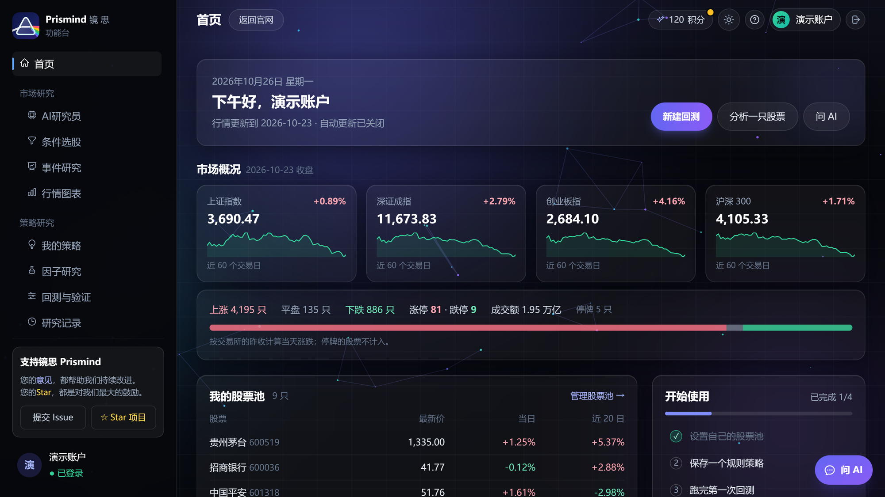
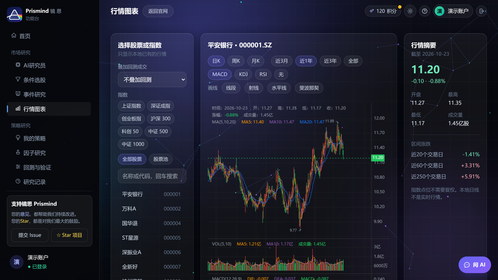
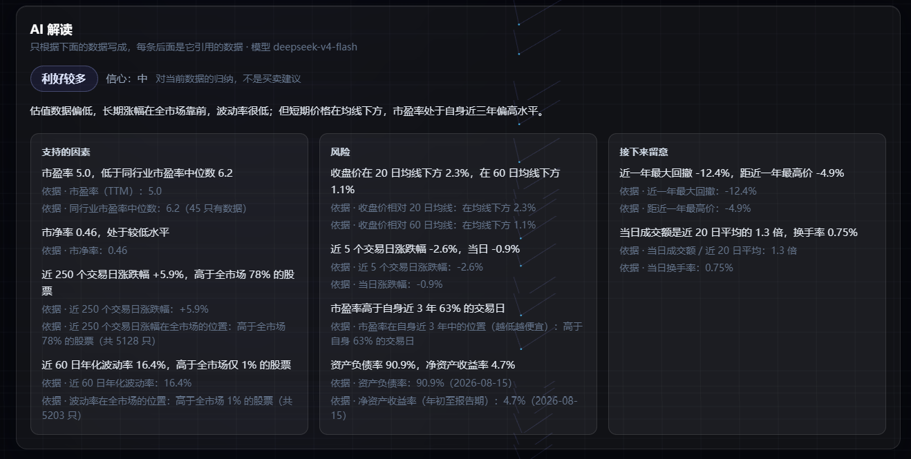

<p align="center">
  
</p>

<h1 align="center">镜思 Prismind</h1>

<p align="center">从投资想法，到可验证的量化研究。</p>

<p align="center">
  <a href="https://getprismind.com"><strong>在线使用：getprismind.com</strong></a>
</p>

<p align="center">
  <a href="README.md"><strong>简体中文</strong></a> · <a href="README.en.md">English</a>
</p>

<p align="center">
  
  
  
  <a href="LICENSE"></a>
</p>

## 🖥️ 实际界面

以下截图来自本项目运行页面（2026-10-26，演示账户），个股以平安银行（000001）为例。

**品牌首页**


**功能台首页：市场概况、涨跌分布、我的股票池**



**行情图表：平安银行日 K 线、均线、成交量和 MACD**



**AI研究员：平安银行的 AI 解读，每条要点下面写着它引用的数据**



## 📖 项目介绍

镜思 Prismind 是面向 A 股的数据研究工作台，基于 **Vue 3 + FastAPI** 构建。它把数据更新、条件选股、策略创建、因子评估、回测验证和 AI 投研放进同一套工作流程，帮助研究者记录和检验自己的投资想法。不用写代码，策略和选股条件都可以用表单或一句话描述来设置。

| 工作区 | 功能 |
| --- | --- |
| AI 智能投研 | AI研究员：用本地数据整理一只股票的走势、估值、财报和风险，AI 只根据这些数据写解读，每条结论都能看到依据；功能台右下角的 AI 问答可以跨股票提问，用到的数据可以展开看 |
| 条件选股 | 自己设条件和排序，筛出最新一个交易日符合条件的股票；AI 可以解读整组结果的共同特征和风险线索；可以直接回测这组条件最近 1～5 年的表现 |
| 我的策略 | 规则策略可以从模板开始、用一句话描述或自己填表单 |
| 因子研究 | 因子库、单因子评估、组合研究 |
| 回测与验证 | 策略回测、参数优化、样本外验证、成交核查；参数优化和滚动验证目前为模拟预览 |
| 模拟账户 | 固定一个规则策略和设置，从创建当天开始，每个交易日数据更新后自动推进；看净值、和沪深 300 比较、持仓和成交记录（每人 3 个） |
| 研究记录 | 历史研究结果与比较 |
| 数据管理 | 数据概览、数据更新、股票池管理 |
| 系统 | 个人中心（改昵称、改密码、注销账户）、积分和每日打卡、设置（默认值、导出自己的全部数据） |

**能力边界：**回测与因子评估需要先下载行情数据。文本 AI 需要服务器配置 DeepSeek、OpenRouter 等 OpenAI 兼容服务的密钥，决策模型 Jev 可以单独配置；没有配置时不显示相应的 AI 结果。WeKnora 文档问答需要独立部署的服务。项目用于研究与模拟，不连接真实资金交易。

## ⚠️ 免责声明

- 镜思 Prismind 是研究工具，只整理和描述历史数据，**不构成任何投资建议**，不推荐具体股票，也不预测价格。
- 回测和因子评估的结果来自历史数据，不代表未来表现。AI 生成的内容可能有错误，请以原始数据为准。
- 行情和财务数据来自 BaoStock、AkShare 等公开数据源，可能有延迟或错误；使用这些数据请遵守数据源各自的使用条款。
- 网站的服务条款、隐私政策和风险提示见 [getprismind.com/legal.html](https://getprismind.com/legal.html)。

## 🚀 快速开始

**准备：**Python 3.11+、Node.js 18+ 和 Git。只做试用的话普通电脑就够；要下载全市场数据、每天自动更新，建议 8 GB 以上内存（全市场更新时最多用约 5 GB），硬盘留 20 GB 以上（全市场行情约 1 GB，加上运行记录和备份）。

```bash
git clone https://github.com/FelixZhang028/Prismind.git
cd Prismind
```

**1. 设置管理员账户**：把 `dashboard/backend/.env.example` 复制成同目录的 `.env`，填上 `FELLOWQUANT_ADMIN_EMAIL` 和 `FELLOWQUANT_ADMIN_PASSWORD`（至少 12 位）。后端第一次启动时会用它们创建管理员；没有公共的默认密码。下载行情数据、管理用户只有管理员能做。

**2. 启动**

**Windows**：在项目根目录运行 `start.bat`。首次运行会检查并安装必要依赖，启动后访问 `http://127.0.0.1:5273`。按任意键停止由脚本启动的服务。

**手动启动 / macOS / Linux**：

```bash
# 终端一：后端
cd dashboard/backend
python -m venv .venv
# macOS / Linux
source .venv/bin/activate
# Windows PowerShell 使用：.\.venv\Scripts\Activate.ps1
python -m pip install -r requirements.txt
python -m uvicorn app.main:app --host 127.0.0.1 --port 8000
```

```bash
# 终端二：从项目根目录进入官网/功能台
cd landing
npm ci
npm run dev -- --host 127.0.0.1
```

**3. 开始使用**：用管理员账户登录，先进入「数据管理 → 数据更新」下载行情数据，再去创建策略、运行回测。管理后台在 `admin/` 里运行 `npm ci` 和 `npm run dev`（端口 5175）。`start.bat` 启动时接口文档在 `http://127.0.0.1:8000/docs`。

> 注册新账户时默认要填发到邮箱的验证码。`start.bat` 在本机会自动关掉这一步，所以没有配置邮件服务也能注册；手动启动时，在 `.env` 里加一行 `FELLOWQUANT_SIGNUP_EMAIL_CODE=off`，或者配好邮件服务（见 [配置说明](docs/CONFIGURATION.md)）。正式网站不要关。

## ⚙️ 常用配置

配置写在 `dashboard/backend/.env` 里，后端启动时自动读取，`.env` 不进入 Git。AI 模型和密钥、AI 次数、积分、每日更新、邮件服务等也可以由管理员在管理后台的“系统设置”里改，保存后立刻生效，优先于 `.env`。配置项以 `FELLOWQUANT_` 开头，这是项目改名以前的名字，保留了下来。

| 配置 | 用途 |
| --- | --- |
| `APP_SECRET` | 登录令牌签名和后台密钥加密；留空时自动生成并保存在本机。换服务器时要和数据一起带走 |
| `FELLOWQUANT_ADMIN_EMAIL` / `FELLOWQUANT_ADMIN_PASSWORD` | 首次创建管理员，初始密码至少 12 位 |
| `FELLOWQUANT_AI_BASE_URL` / `FELLOWQUANT_AI_MODEL` / `FELLOWQUANT_AI_API_KEY` | 文本 AI 模型（任意 OpenAI 兼容服务，例如 DeepSeek）；用 OpenRouter 时只填 `OPENROUTER_API_KEY` |
| `FELLOWQUANT_AI_DAILY_TOTAL` | 全站每天最多调用多少次 AI（默认 500），防止费用失控 |
| `SMTP_HOST` / `SMTP_PORT` / `SMTP_USERNAME` / `SMTP_PASSWORD` / `SMTP_FROM` | 发注册验证码和找回密码验证码的邮件服务（163 邮箱：`smtp.163.com`、465，密码填授权码） |
| `FELLOWQUANT_REGISTRATION` / `FELLOWQUANT_INVITE_CODES` | 注册方式和邀请码，一般在管理后台“注册与邀请码”里设置 |
| `FELLOWQUANT_DAILY_UPDATE` / `FELLOWQUANT_BAOSTOCK_INTERVAL` | 每个交易日收盘后自动更新全市场数据（默认开启）、BaoStock 请求间隔 |
| `FELLOWQUANT_BACKUP_DIR` | 每天自动备份账户数据库和登录密钥的目录，最好设在另一块硬盘 |

全部配置项（AI 次数、积分规则、计算限制、备份、限流等）和 Jev、WeKnora 的说明见 **[配置说明](docs/CONFIGURATION.md)**。

## 🌐 正式部署

线上网站 [getprismind.com](https://getprismind.com) 跑在 Linux 云服务器上（Nginx 提供 https）。第一次准备服务器、搬数据、`scripts/deploy.sh` 一条命令部署和回退、切换域名，见 **[部署到云服务器](docs/DEPLOY_SERVER.md)**。

上线前在 `.env` 或管理后台里至少确认：`APP_SECRET`、管理员账户、AI 模型密钥、`FELLOWQUANT_AI_DAILY_TOTAL`、注册方式、邮件服务（注册要验证邮箱）、`FELLOWQUANT_CLIENT_IP_HEADER` 和备份目录。后端只开一个进程（次数限制和后台任务记在这个进程里），不要开多个 worker。

| 文档 | 内容 |
| --- | --- |
| [部署到云服务器](docs/DEPLOY_SERVER.md) | 准备服务器、搬数据、部署和回退、切换域名、日常查看 |
| [运行和维护](docs/OPERATIONS.md) | 每日数据更新、计算限制、账户和安全、单进程运行、在自己电脑上用 Cloudflare Tunnel 临时公开、条款和隐私政策 |
| [管理后台](docs/ADMIN.md) | 用户、注册与邀请码、违禁词、积分与兑换码、数据更新、系统设置、操作记录 |
| [配置说明](docs/CONFIGURATION.md) | 全部配置项，Jev 和 WeKnora |
| [Jev 使用文档](docs/JEV_USAGE.md) | 决策模型的配置、网页操作、API 示例和故障排查 |

## ❓ 常见问题

**注册时提示“网站还没有配置邮件服务”**：注册要先验证邮箱。在管理后台“系统设置 → 邮件服务”填好并发一封测试邮件；只是在自己电脑上试用，见上面“快速开始”里的说明。

**收不到验证码邮件**：先看垃圾邮件文件夹；再在管理后台发一封测试邮件，检查服务器、端口和授权码（163、QQ 邮箱填的是授权码，不是登录密码）。

**数据更新提示“黑名单用户”**：BaoStock 会暂时拉黑短时间内请求太多的服务器。任务会自动停下、当天不再重试；把 `FELLOWQUANT_BAOSTOCK_INTERVAL` 调大（例如 0.5），第二天再试。

**`start.bat` 提示端口被占用**：本机 8000 或 5273 端口被别的程序占着。脚本会自动停止自己上次遗留的进程；如果是别的程序，先关掉它。

**看不到 AI 解读**：服务器还没有配置 AI 模型的密钥，或者今天的免费次数和积分用完了。管理员可以在“系统设置 → AI 模型”里点“测试文本模型”检查。

## 🧩 项目结构

```text
.
├── landing/              # Vue 官网、登录、功能台、法律页面
├── admin/                # 管理后台（正式部署时在 /admin/）
├── dashboard/
│   └── backend/
│       ├── app/          # FastAPI 路由、认证、数据库
│       ├── quant_platform/  # 量化研究、WeKnora 与 Jev 适配器
│       ├── trading_agents/  # AI 投研流程
│       ├── configs/      # 数据源、策略、风险配置
│       └── tests/        # 回归测试
├── deploy/server/        # 云服务器上的服务、Nginx 配置和安装脚本
├── docs/                 # 部署、运维、管理后台、配置文档和页面截图
├── scripts/start.ps1    # Windows 本机开发：启动前后端与清理
├── scripts/serve.ps1 / serve.sh  # 打包网页，由后端一起提供
├── scripts/deploy.sh    # 部署到云服务器
├── scripts/tunnel.ps1   # 在自己电脑上用 Cloudflare Tunnel 公开网站（备用）
└── start.bat
```

## 🧪 开发与验证

```bash
cd dashboard/backend
python -m pip install -r requirements-dev.txt
python -m pytest -q
python -m compileall -q app quant_platform trading_agents
```

在 `landing/`、`admin/` 各自执行 `npm ci`、`node --test tests/*.test.js`、`npm run build`。回归测试覆盖成交核查、外部服务协议、账户配置隔离、认证、注册验证码、积分和密码重置；外部服务和邮件都使用模拟，不产生模型费用、不会真的发邮件。

## 🤝 参与贡献

欢迎通过 [Issue](https://github.com/FelixZhang028/Prismind/issues) 反馈问题、提出功能建议，或提交 Pull Request。反馈时请说明复现步骤、预期行为和实际行为；提交代码前请先跑一遍上面的测试。发现安全问题请不要公开提 Issue，按 [SECURITY.md](SECURITY.md) 私下联系。

感谢 AlphaQuant 的量化研究基础，以及 [BaoStock](http://baostock.com/)、[AkShare](https://github.com/akfamily/akshare)、[WeKnora](https://github.com/Tencent/WeKnora) 和 [OpenRouter](https://openrouter.ai/) 提供的数据和集成能力。

## 📬 联系方式

邮箱：prismind_ai@163.com

## 📄 许可证

项目采用 [GNU GPL v3](LICENSE)。
